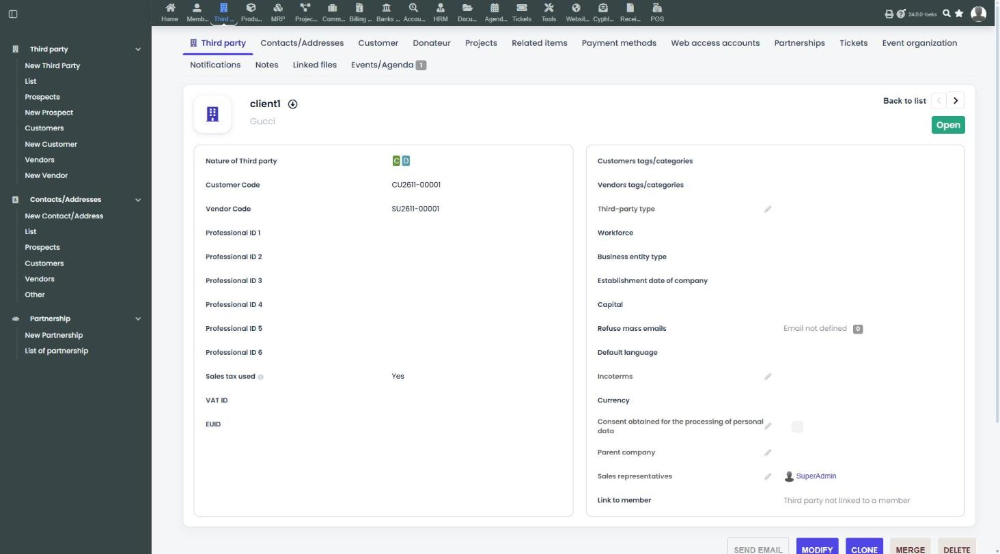
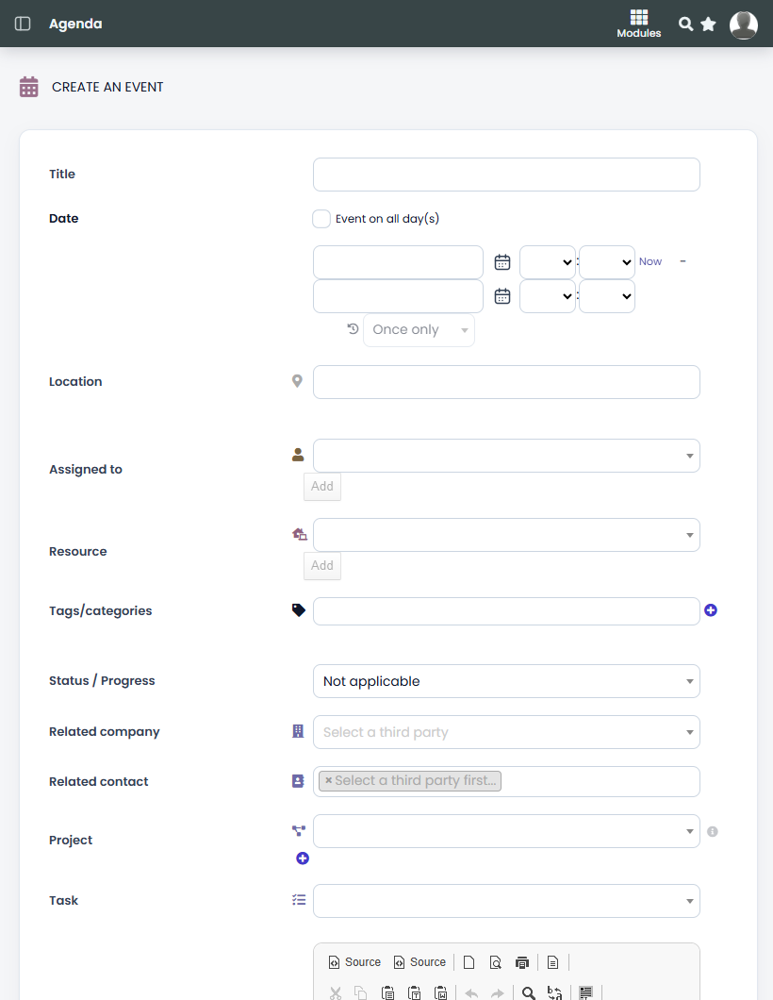
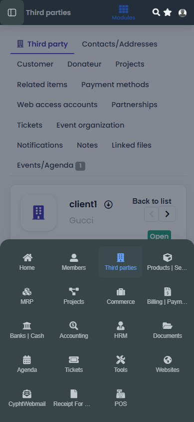

# Neutron

A modern interface for Dolibarr, as a module: it ships the theme `neutron`, built on the theme `md`, and a few
scripts for the menus. No core file is changed.

Neutron is free and open source software, under the [GNU GPL v3 or later](#license). Contributions are welcome.

## What it changes

| Part | Changes |
| --- | --- |
| Top bar | Slate bar, highlight of the current module, user menu |
| Left menu | Full height column that reduces to icons, hover preview, foldable sections, current page |
| Tabs and lists | Thick line under the current tab, lists in rounded panels |
| Forms | One field style and width, select lists, checkboxes, radios, date picker |
| Record cards | Two panels side by side, photo, readable labels |
| Tablets and phones | Left menu as a drawer, modules in a sheet that opens from the bottom |
| Font and texts | Poppins, bundled; texts of the module in English and French |

## Screenshots

### Computer



### Tablet and phone

| Tablet: create form | Phone: modules |
| --- | --- |
|  |  |

## Requirements

- Dolibarr 23 or later.
- PHP 7.2 or later.
- A recent browser: the styles use `:has()` and `color-mix()` (Chrome and Edge 111+, Firefox 121+, Safari 16.2+).
- JavaScript, for the behaviours of the menus.

## Install

1. Get the module into `htdocs/custom/neutron`. From the Dolibarr folder:

   ```bash
   git clone https://github.com/camilevahviraki/Dolibarr-UX-improvement-module-Neutron.git htdocs/custom/neutron
   ```

   The folder must be named `neutron`, and Dolibarr must load the `custom` folder
   (`$dolibarr_main_document_root_alt` in `htdocs/conf/conf.php`).
2. Enable the module **Neutron** in *Setup > Modules*.
3. Select the theme `neutron` in *Setup > Display > Theme*, then save.

## Update

1. Update the folder (`git pull`).
2. If the update adds or renames a script, disable and enable the module: Dolibarr records the list of scripts when
   the module is enabled. Disabling selects the theme `eldy` again, so select `neutron` once more.
3. If the old look remains, reload the page without the browser cache.

To remove the module, disable it in *Setup > Modules*, then delete the folder.

## Documentation

| Page | Content |
| --- | --- |
| [Using Neutron](docs/usage.md) | Screens, colors, translations, known limits |
| [Structure](docs/structure.md) | Folders and files, where to add something |
| [Styles and overrides](docs/styles.md) | Rules for the styles |
| [Contributing](CONTRIBUTING.md) | Branches, commits, code, checks, pull requests |
| [Changelog](ChangeLog.md) | What changed |

## License

Neutron is free software: you can redistribute it and modify it under the terms of the GNU General Public License
as published by the Free Software Foundation, either version 3 of the License, or (at your option) any later
version. It is distributed without any warranty. The full text is in [COPYING](COPYING). This is the license of
Dolibarr itself.

The font Poppins, in `fonts/`, keeps its own license, the SIL Open Font License:
[fonts/LICENSE-Poppins.txt](fonts/LICENSE-Poppins.txt).
